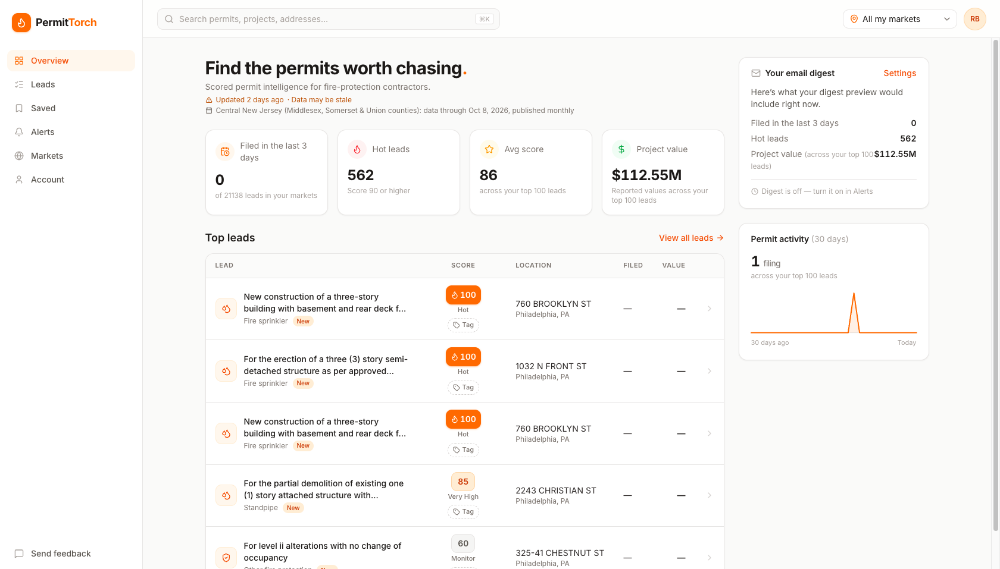
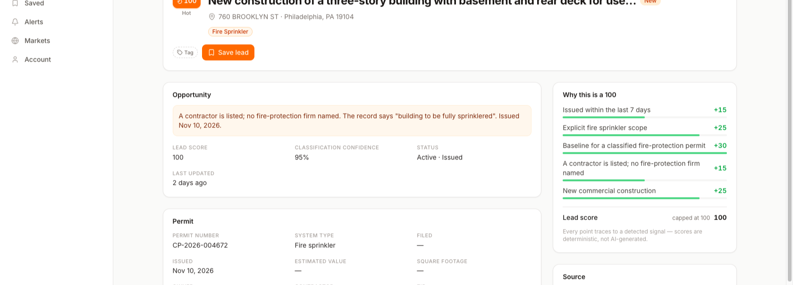
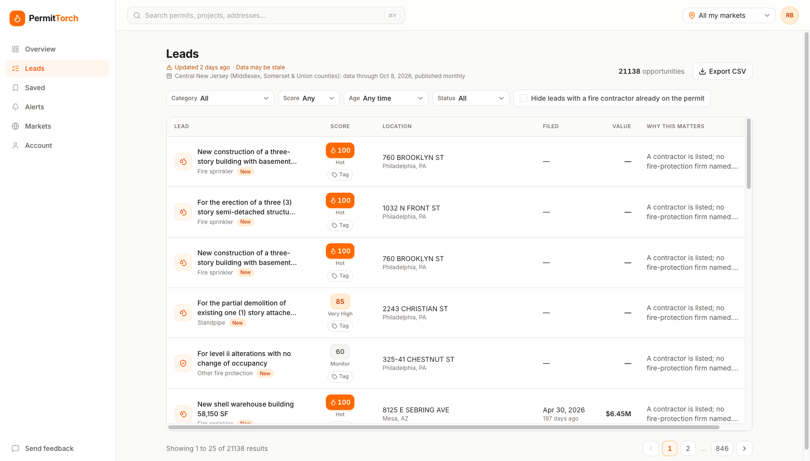
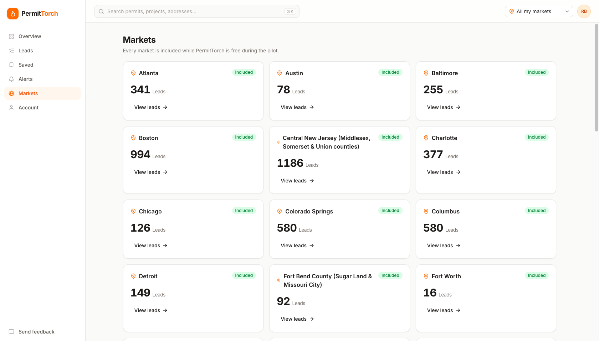
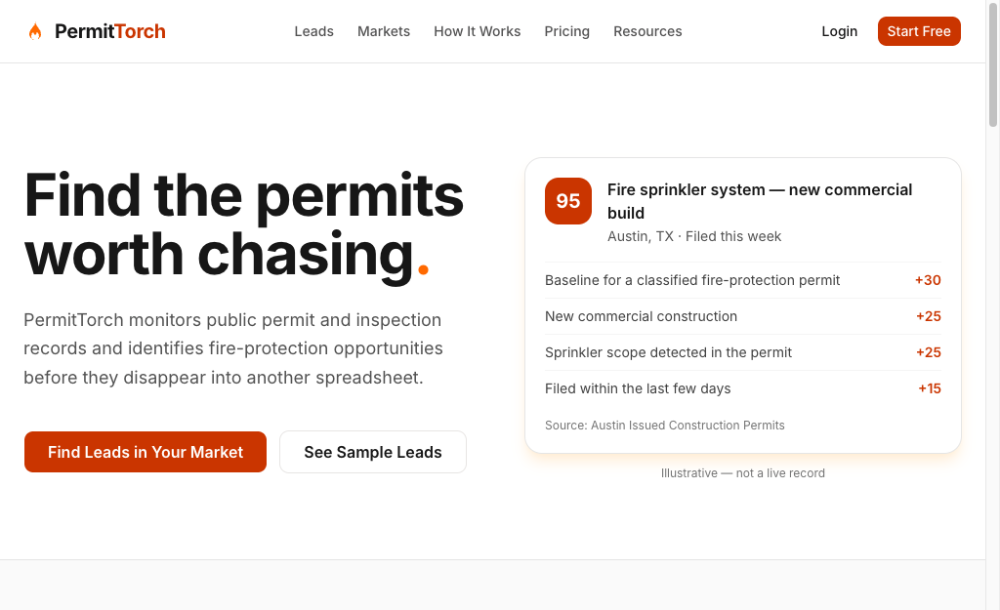
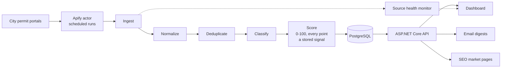

# PermitTorch

**Lead intelligence for fire-protection contractors.** PermitTorch reads public permit and inspection records from city portals, works out which ones are real fire-sprinkler, alarm and suppression opportunities, and ranks them with a 0–100 score that explains itself point by point.

**Live at [permittorch.com](https://permittorch.com) — free to try.** [Create an account](https://permittorch.com/signup) with an email and password (or Google) and you are looking at real, scored leads in under a minute. No card, no sales call.

[](https://github.com/andypnguyen11-gif/permittorch/actions/workflows/ci.yml)



## What it does

A sprinkler contractor's best leads are sitting in municipal permit portals, days or weeks before anyone calls them. Reading 50 portals by hand is nobody's job. PermitTorch does it every night:

- **Ingests** permit, inspection and violation records from 56 public sources covering 39 markets in 26 states.
- **Normalizes** every source's own field names and formats into one canonical permit model.
- **Deduplicates** on source + record id, with an address/type/date fingerprint as a fallback, so the same job never shows up twice.
- **Classifies** each record (sprinkler, alarm, suppression, kitchen hood, inspection, violation correction) with keyword and pattern rules, and stores a confidence.
- **Scores** each opportunity 0–100 with a deterministic rule engine. Every point is persisted as a signal, so the lead page shows exactly why a lead scored what it did.
- **Delivers** the result as a filterable lead table, saved leads, CSV export, and daily or weekly email digests.

As of November 2026 the production database holds about 27,000 permits and 21,000 scored opportunities.

| Explainable score | Lead table |
| --- | --- |
|  |  |

| Markets | Marketing site |
| --- | --- |
|  |  |

## Tech stack

| Layer | Technology |
| --- | --- |
| Web | Next.js 15 (App Router), React 19, TypeScript, Tailwind CSS, shadcn/ui, Zod, React Hook Form |
| API | ASP.NET Core on .NET 10 (C#), EF Core 10, background services for ingestion, rescoring, digests and source health |
| Database | PostgreSQL 17 |
| Auth | Firebase Auth (email/password and Google), ID tokens validated by the API |
| Billing | Stripe Checkout and webhooks (signature-verified) |
| Email | Resend, with HMAC-signed one-click unsubscribe |
| Data collection | An [Apify actor](https://apify.com/scrapelabmax/us-fire-permit-leads-scraper) I built and publish separately |
| Hosting | Railway (web, API and Postgres), Docker images, auto-deploy from `main` |
| Observability | Sentry, PostHog |
| Testing | xUnit + Testcontainers, Vitest + Testing Library, Playwright |
| CI | GitHub Actions: build, typecheck and all tests on every pull request |

## How it works



The scraper lives in its own repository and is published on the Apify Store as the [US Fire Permit Leads Scraper](https://apify.com/scrapelabmax/us-fire-permit-leads-scraper). This repository is everything downstream of it: the pipeline, the API, and the web app.

## Engineering decisions worth a look

- **The score is deterministic and explainable.** No LLM sits in the scoring path. Weights live in configuration, each contributing rule is saved as a `LeadSignal` row, and the UI renders that exact breakdown. Scores are versioned, so a change to the rules can be measured against what contractors report back.
- **Awarded jobs are not leads.** A fire permit that already names a fire-protection contractor is usually work someone else has won. The engine penalises it heavily rather than ranking it first, and the UI says only what the record shows ("a fire-protection contractor is on this permit"), never what it implies.
- **Stale data is never shown as current.** A health monitor tracks every source. When a feed stops updating, the dashboard says "Data may be stale" instead of quietly serving old leads. You can see that banner in the screenshots above.
- **The scraper is behind an interface.** All Apify-specific code sits behind `IPermitSourceProvider`. Raw scraper shapes never reach domain code or the frontend, and the scraper's own score is treated as an input signal at most.
- **A new city is configuration, not code.** Adding a market means registering a source; the pipeline stages are source-agnostic.
- **Authorization is server-side.** Market entitlements are enforced inside the API's queries, admin endpoints check roles, and input is validated at the API boundary. Hiding a button is never the access control.
- **Modular monolith, vertical slices.** API features live in `Features/<Name>/` (Leads, SavedLeads, Billing, EmailDigests, Admin and so on) rather than in generic controller and service folders. No Redis, Kafka or Kubernetes until a measurement asks for one.
- **Privacy by design.** Contact details come only from the permit record itself, are shown only to signed-in users, and never appear on a public page. A removal list lets anyone have their details taken out, and removals survive re-ingestion.

## Testing

Every pull request ships with tests, and a bug fix ships with a regression test that fails without it.

- **API:** 1,300+ xUnit tests. Integration tests run against a real PostgreSQL in Testcontainers and cover endpoints, authorization, ingestion, deduplication, classification and scoring.
- **Web:** Vitest and Testing Library component and unit tests across about 70 test files.
- **End to end:** Playwright specs for the critical flows (sign up, view and filter leads, saved leads, admin).

## Repository layout

```text
apps/
  api/        ASP.NET Core API: Domain/ (normalization, classification, scoring),
              Features/ (vertical slices), Infrastructure/ (the Apify provider), Jobs/
  web/        Next.js app: marketing site, signed-in app, admin
packages/
  types/      API contract types shared with the web app
e2e/          Playwright suite
docs/         Deployment guide, decisions, legal research
```

Product and design documents are in the repository root: [Prd.md](Prd.md), [Architecture.md](Architecture.md) and [Tasks.md](Tasks.md).

## Running it locally

You need Docker, the .NET 10 SDK, Node 22+ and pnpm.

```bash
cp .env.example .env                 # then fill in Firebase and Stripe test values
docker compose up -d                 # PostgreSQL
pnpm install

# Migrate and seed markets and sources (set SEED_SAMPLE_DATA=true in .env for sample leads)
set -a; source .env; set +a
dotnet run --project apps/api/PermitTorch.Api.csproj --no-launch-profile -- seed

# API on :5050
dotnet run --project apps/api/PermitTorch.Api.csproj --no-launch-profile --urls http://localhost:5050

# Web on :3000 (in another terminal)
pnpm --dir apps/web dev -p 3000
```

Run the tests:

```bash
dotnet test apps/api/PermitTorch.sln   # API (needs Docker for Testcontainers)
pnpm test                              # web
pnpm e2e                               # Playwright, against the running stack
```

Deployment is documented in [docs/deploy.md](docs/deploy.md).

## Status

PermitTorch is in a free pilot: every account sees every active market at no charge while the scoring is tuned against feedback from working contractors. Stripe billing is built and switched off for the pilot.

## About

Designed and built by [Andy Nguyen](https://github.com/andypnguyen11-gif). The fastest way to judge the work is to [sign up](https://permittorch.com/signup) and click around.
